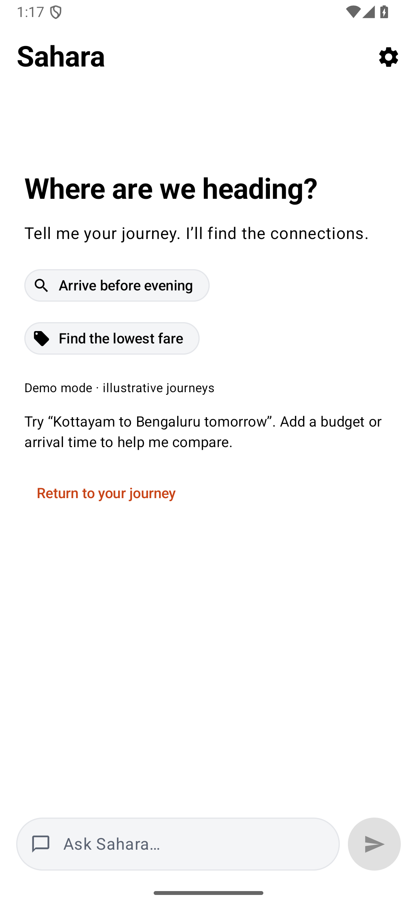
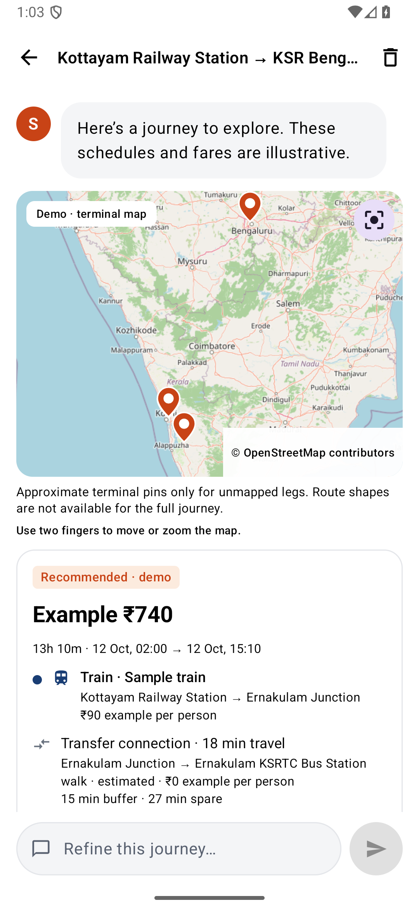
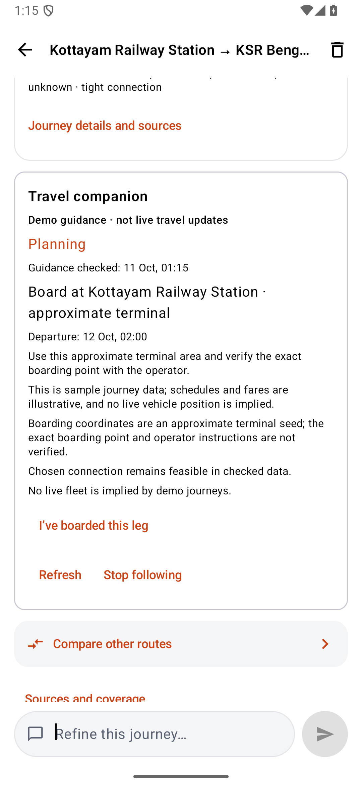

# Sahara — Multimodal Commute Intelligence & Real-Time Passenger Companion

[](https://developer.android.com)
[](https://kotlinlang.org)
[](https://developer.android.com/jetpack/compose)
[](https://www.python.org)
[](https://fastapi.tiangolo.com)
[](https://modelcontextprotocol.io)
[](https://sqlite.org)

**Sahara** is an end-to-end multimodal transit intelligence and navigation ecosystem tailored for complex journeys across India. It unifies **Rail, Intercity Buses (KSRTC Swift), Flights, and Local Transit** into a cohesive, evidence-backed itinerary planner with real-time driver fleet telemetry, interactive OpenStreetMap navigation, and step-by-step travel guidance.

---

## 📸 Interface Showcase

| Search & Exploration | Multimodal Comparison | Step-by-Step Companion |
| :---: | :---: | :---: |
|  |  |  |
| *Natural language query with instant terminal auto-suggestions* | *Side-by-side price, duration, transfer, and mode comparison* | *Active journey tracking with boarding alerts & connection margins* |

---

## ⚡ Core Features

- 🚆 **True Multimodal Journey Planning**: Connects Indian Railways (ConfirmTkt/RailYatri parsed DOMs), state and intercity bus routes (Kerala KSRTC Swift DOM parser), domestic flight quotes (Google Flights rendered DOM), and walking access/egress links into single verified itineraries.
- 💬 **Constraint & Intent-Aware AI Assistant**: Natural language travel parsing powered by OpenRouter / DeepSeek with strict deterministic planning rules. The AI understands budgets, transfers, departure deadlines, walking limits, and accessibility constraints without inventing non-existent inventory.
- 🧭 **Real-Time Passenger Companion**:
  - Live step-by-step boarding instructions with exact terminal pinpoints.
  - Connection margin warnings and dynamic transfer buffer tracking.
  - Manual boarding and leg completion validation following strict chronological travel order.
  - Automatic replanning on disruption while locking already-travelled legs.
- 🗺️ **Interactive OpenStreetMap Integration**: Native map rendering with hardware acceleration, terminal pins, route shapes, fit-to-route controls, and zoom/pan gestures.
- 🚌 **Live Driver Fleet Adapter**: Read-only connection to the [Sahara Driver](https://github.com/JAN1729/Sahara) Supabase database (`vehicles`, `route_stops`, `locations`), streaming real-time bus positions onto the user map.
- 🌐 **VisaGuy MCP Federation Gateway**: Standalone Model Context Protocol (MCP 2.3.0) package with 20 tools, TypeSafe JEV System-1 intent hyperclassification (<10ms latency), and cross-border commute travel advisory.
- 📡 **Resilient SSE Streaming**: Server-Sent Events (SSE) stream incremental event frames to the Android app, showing real-time planning progress and partial source collector status.

---

## 🏗️ System Architecture

```
┌─────────────────────────────────────────────────────────────────────────────┐
│                       Sahara Android Client (Kotlin)                        │
│   Jetpack Compose UI  •  OSMdroid Map Engine  •  Foreground Journey Monitor  │
└──────────────────────────────────────┬──────────────────────────────────────┘
                                       │ HTTP / SSE Stream
                                       ▼
┌─────────────────────────────────────────────────────────────────────────────┐
│                    Central Planning Server (FastAPI)                        │
│                                                                             │
│  ┌──────────────────────────┐             ┌──────────────────────────────┐  │
│  │   NLU Language Parser    │             │   Multimodal Journey Graph   │  │
│  │ (OpenRouter / DeepSeek)  │             │   • Chronological Search     │  │
│  └─────────────┬────────────┘             │   • Transfer Buffer Planning │  │
│                │                          │   • Disruption Replanner     │  │
│                ▼                          └──────────────┬───────────────┘  │
│  ┌──────────────────────────┐                            │                  │
│  │    SQLite WAL Storage    │                            │                  │
│  │  (Journeys, Progress)    │                            │                  │
│  └──────────────────────────┘                            │                  │
└───────────────────┬──────────────────────────────────────┼──────────────────┘
                    │                                      │
         ┌──────────┴──────────┐                ┌──────────┴──────────┐
         ▼                     ▼                ▼                     ▼
┌─────────────────┐   ┌─────────────────┐   ┌─────────────────┐   ┌─────────────────┐
│ Public Rail DOM │   │ KSRTC Swift DOM │   │  Google Flights │   │  Sahara Driver  │
│    Collector    │   │    Collector    │   │   DOM Collector │   │ Supabase Fleet  │
└─────────────────┘   └─────────────────┘   └─────────────────┘   └─────────────────┘
                               │
                               ▼
┌─────────────────────────────────────────────────────────────────────────────┐
│                   VisaGuy MCP 2.3.0 Federation Gateway                      │
│   TypeSafe JEV System-1 Hyperclassifier  •  Cross-Border Travel Advisory    │
└─────────────────────────────────────────────────────────────────────────────┘
```

---

## 📁 Repository Structure

```
Sahara/
├── app/                              # Android Passenger Client (Kotlin / Compose)
│   ├── src/main/
│   │   ├── java/com/sahara/user/
│   │   │   ├── data/api/             # CommuteBackend, SSE EventFrames, JourneyGuidance
│   │   │   ├── ui/screens/           # HomeScreen, ChatScreen, ServerScreen
│   │   │   ├── ui/components/        # JourneyResults, JourneyFollowPanel, MapPanel
│   │   │   └── service/              # RealtimeBusManager (Supabase driver adapter)
│   │   └── res/                      # Terminal pins, XML themes, vector drawables
│   └── src/test/                     # Android Unit Tests (Contracts, Guidance, Maps)
│
├── backend/                          # Central Planning Server (Python / FastAPI)
│   ├── sahara/
│   │   ├── api.py                    # REST and SSE API endpoints
│   │   ├── broker.py                 # Real-time event broker & frame dispatch
│   │   ├── planner.py                # Multimodal chronological journey planner
│   │   ├── language.py               # OpenRouter / DeepSeek NLU request parser
│   │   ├── guidance.py               # Real-time companion boarding & connection guidance
│   │   ├── storage.py                # SQLite WAL storage engine
│   │   └── providers/                # Rail, KSRTC bus, and Flight DOM collectors
│   ├── tests/                        # 79 passing unit & regression tests
│   └── start-central-server.ps1      # One-click startup script for Windows
│
├── visaguy_mcp/                      # Standalone MCP 2.3.0 Connector Package
│   ├── visaguy_mcp/
│   │   ├── server.py                 # MCP Server exposing 20 registered tools
│   │   ├── hyperclassifier.py        # TypeSafe JEV System-1 routing (<10ms)
│   │   ├── federation.py             # Multi-MCP travel federation registry
│   │   └── gateway.py                # FastAPI SSE gateway for remote MCP clients
│   └── tests/                        # 15 MCP end-to-end integration tests
│
└── docs/                             # Engineering Documentation
    └── commute/
        ├── CENTRAL_SERVER_RUNBOOK.md # Detailed server deployment runbook
        ├── CENTRAL_SERVER_DESIGN.md  # Architectural deep-dive
        ├── DELIVERY_2026-10-11.md    # Pilot delivery report and operational limits
        └── APP_UI_VERIFICATION_2026-10-10.md # UI verification and test ledger
```

---

## 🚀 Quick Start Guide

### 1. Prerequisites
- **Android**: Android Studio Ladybug+ with JDK 17, Android SDK 26+
- **Backend**: Python 3.11 or newer, Windows / Linux / macOS
- **Git**

---

### 2. Launch the Central Planning Server

```powershell
cd backend

# Create and activate virtual environment
python -m venv .venv
.\.venv\Scripts\Activate.ps1

# Install package and dependencies
pip install -e .

# Configure environment
Copy-Item .env.example .env
# Edit .env and supply your OPENROUTER_API_KEY (optional, falls back to rule-based parser)

# Start server (default: port 8787)
.\start-central-server.ps1
# Or directly via uvicorn:
# uvicorn sahara.api:app --host 0.0.0.0 --port 8787
```

*Server diagnostics are available at `http://127.0.0.1:8787`.*

---

### 3. Build & Run Android Passenger App

1. Open Android Studio and select `Sahara/`.
2. Let Gradle sync project dependencies.
3. Configure Backend Connection:
   - **Android Emulator**: Automatically defaults to `http://10.0.2.2:8787`.
   - **Physical Device**: Tap **Server Settings** in the app header and enter your computer's local LAN IP (e.g., `http://192.168.1.15:8787`).
4. Click **Run** (`Shift + F10`) to deploy to your device or emulator.

---

### 4. (Optional) Run VisaGuy MCP Server

```powershell
cd visaguy_mcp

# Install in editable mode
pip install -e .

# Run MCP server in stdio mode:
python -m visaguy_mcp.cli serve --transport stdio

# Or launch SSE gateway on port 8000:
python -m visaguy_mcp.gateway 8000
```

---

## 🧪 Verification & Test Suite

The codebase is backed by comprehensive unit and integration test suites:

- **Backend**: **79 / 79 tests passing** (`python -m unittest discover -s backend/tests -q`)
  - Validates multimodal search, chronological transfers, sold-out services, late departure rollovers, and locked-prefix recovery.
- **Android**: **All unit tests passing** (`./gradlew :app:testDebugUnitTest`)
  - Validates SSE stream parsing (`EventFramesTest`), guidance state machines (`JourneyGuidanceTest`), contract mappings (`JourneyContractTest`), and gesture states (`MapGestureStateTest`).
- **VisaGuy MCP**: **15 / 15 tests passing** (`pytest visaguy_mcp/tests`)
  - Validates sub-10ms hyperclassification, doorway discovery, federation registrations, and travel advisory tools.

---

## 🔒 Security & Data Hygiene

- API secrets, keystores, and local environment files (`.env`, `local.properties`) are strictly ignored via `.gitignore`.
- Production APK builds omit debug gateway tokens and developer endpoints.
- Supabase driver fleet telemetry operates over a read-only role with no write permissions to driver schedules.

---

## 📜 License

Private & Proprietary — All rights reserved.
