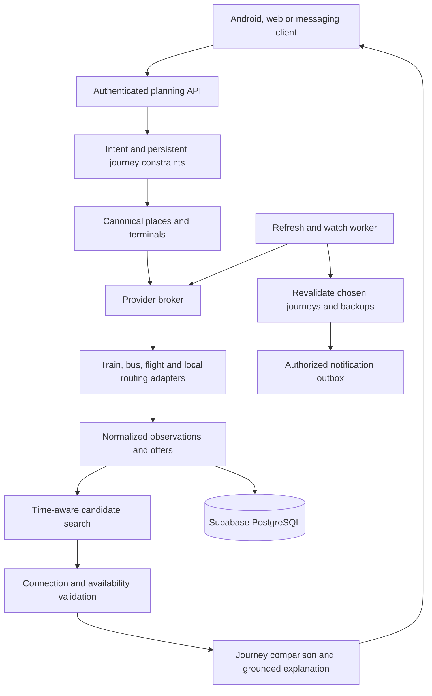

# Sahara multimodal backend: research and proposed design

Date: 9 October 2026. Status: proposed design for review; no product implementation or deployment has been performed.

## Intended outcome and agreed scope

Build a useful India-first backend that assembles door-to-door journeys across walking/local transit, trains and intercity buses, with flights only when real provider data is available. The broader architecture must support international air journeys later. The user selected India journeys as the first demo priority for the 10 October buildathon.

The strongest product hypothesis is:

> Find an available journey that fits my deadline and budget, verify that its connections work, show the real total cost and evidence, and give me a useful fallback if something changes.

This is a recommendation, not a proven market-demand result or a claim that no competitor offers related functionality. Beating every LLM or every transport planner is not a measurable release criterion. Benchmark the specific journey tasks below.

Assumptions for the first build: one developer-sized implementation, a corridor with usable data, search and monitoring rather than ticket purchase, conservative connection rules, and explicitly labelled missing coverage. The exact corridor should be chosen after adapter verification; Kerala plus an interstate destination is a natural candidate given existing code, not verified coverage.

## Research evidence and its limits

A focused web search examined Reddit reports plus official competitor and technical documentation. This is qualitative discovery, not a representative survey; reports are self-selected, unverified individual experiences. No frequency, willingness-to-pay or market-size claims are inferred from the sample.

| User problem | Evidence | Backend implication |
|---|---|---|
| A delayed leg ruins onward travel | [India train-to-flight example](https://www.reddit.com/r/indianrailways/comments/1pn0lwf/i_might_miss_my_flight_today/), [flight-to-train example](https://www.reddit.com/r/AirTravelIndia/comments/1pn4m20/flight_delay_caused_me_to_miss_a_prebooked_train/) | Plan against the final deadline and monitor dependencies between legs |
| Cheaper separate tickets conceal connection exposure | [Separate flights report](https://www.reddit.com/r/travel/comments/1ugbg9g/i_saved_180_by_booking_separate_flights_it_may/) | Distinguish ticket grouping, protection, terminal movement and check-in deadlines |
| A listed boarding point can be misleading | [Boarding-point report](https://www.reddit.com/r/LegalAdviceIndia/comments/1ogdse7/redbus_shared_wrong_pickup_location_operator_left/) | Store exact boarding coordinates, instructions and verification state |
| Lowest-cost suggestions can omit practical alternatives | [Chennai comparison report](https://www.reddit.com/r/chennaicity/comments/1qr2zk1/google_maps_lowest_cost_filter_still_pushes/) | Compare complete journeys, not headline ticket fares |
| Aggregators are used for discovery, then independently checked | [Rome2Rio discussion](https://www.reddit.com/r/travel/comments/1bo4syl), [Europe planning discussion](https://www.reddit.com/r/Europetravel/comments/17iruaj) | Attach operator/source links, observation age and revalidation to recommendations |
| Local knowledge can improve mode combinations | [India journey discussion](https://www.reddit.com/r/TravelInIndia/comments/1ucczcn/travelling_in_india_is_unnecessarily_confusing/) | Include local access/egress and operator coverage; this thread has weak evidential weight because it includes discussion of app promotion |

The proposed feature priority follows severity, fit with the existing code and demonstrability, not a fabricated survey score:

1. Valid, available connections with explicit deadlines.
2. Door-to-door cost and timing, including access/egress.
3. Clear freshness, provenance and missing-data labels.
4. A revalidated fallback when the chosen journey is disrupted.
5. Accurate boarding/transfer guidance.
6. Persistent English/Malayalam conversational refinements.
7. Airport access and real flight offers.

## Competitive boundary

Multimodal discovery itself already exists. [Rome2Rio](https://www.rome2rio.com/about/) spans different transport modes, and its [help page](https://help.rome2rio.com/en/support/solutions/articles/22000295494-why-do-i-need-to-book-each-leg-separately-) explains why some legs must be booked separately. [Moovit Assistant](https://moovit.com/press-releases/moovit-assistant/) describes personalized AI recommendations and realtime journey management. [Transit GO](https://help.transitapp.com/article/91-what-is-go-crowdsourcing) addresses realtime data gaps through riders. [Kiwi](https://www.kiwi.com/au/help/travel-disruptions-cancellations-272/article/what-s-connection-protection-558/) offers a form of self-transfer disruption protection. [redBus](https://www.redbus.in/information/know-your-rzone) already addresses boarding-point navigation in selected locations.

Sahara should not pitch AI, multiple agents, fallback travel or boarding guidance as individually unprecedented. The plausible distinction is trustworthy, available India-specific combinations across fragmented providers, especially around deadline-sensitive trips and failures, with transparent evidence. Validate that advantage on actual corridor tasks.

## Existing-code assessment

See [the train-monitor review](TRAIN_MONITOR_REVIEW.md) for the full second-project analysis.

Sahara provides Compose screens, GPS acquisition, local route data, map rendering/tools, and a Deno query pipeline. Its normal Home-to-ThinkingScreen flow does not render the route-map state. It uses placeholder identity, buffers its response events, and has schema/API mismatches. Its active main endpoint performs heuristic route calculations and optional AI explanation; it is not a general timetable planner.

Train-monitor provides Python train/bus acquisition, station and Malayalam resolution, cached availability, persisted channel sessions, PNR watches, daily commute reminders and calendar files. Its alternate-route code chooses legs independently and adds 60 minutes without proving chronological connectivity. Its live train parser labels scheduled clock values as actual times. Its confidence/confirmation percentages are heuristics.

Both projects have useful parts. Combining their monoliths would inherit duplicated domain rules, incompatible user schemas, timezone ambiguity and loosely typed provider results. Extract adapters and reusable concepts instead.

## Three architecture choices

| Choice | Benefit | Cost and limitation |
|---|---|---|
| Extend Sahara's single Edge Function | Small initial integration change | Poor place for browser-backed Python workers; grows a fragile monolith and retains route limitations |
| Python modular backend + ingestion worker + Supabase | Reuses train adapters; separates collection, planning and presentation; appropriate for a corridor prototype | Requires a container/API host and explicit contracts |
| OpenTripPlanner regional routing + broker for train/bus offers/flights | Strong standards-based local routing foundation | Depends on usable GTFS/OSM feeds and adds graph deployment/operations |

Recommendation: start with the second choice as a modular monolith, with a separate process for browser work. Add OpenTripPlanner behind a local-routing adapter when data coverage justifies it. Do not deploy multiple agent microservices for the demo. [OpenTripPlanner](https://docs.opentripplanner.org/en/latest/) already supports scheduled public transport with walking and mobility modes using GTFS and OpenStreetMap, so reuse it where suitable instead of rebuilding mature local routing.

## Proposed components and flow

The planning core should be callable without an LLM. The LLM translates requests into typed constraints and explains already validated itineraries. It does not invent timetables, prices, geography or connection eligibility. Geography and source discovery can use tools, but tool output must be normalized and validated before becoming a route edge.

Every provider has a common interface for discovery, search, status refresh, offer revalidation and capabilities. Providers may implement only some operations. Flight-status access does not imply price/inventory access; a train schedule does not imply available seats.

## Data contracts

### Journey request

Required: origin and destination place references, a departure window or arrive-by deadline with timezone, passenger count, allowed modes and desired preference. Optional: budget/currency, maximum transfers/walk, accessibility requirements, baggage, seat requirements, booked legs and tolerance for overnight travel.

Represent travel preferences as constraints plus priorities rather than a vague "best" flag. Preserve unchanged constraints when users refine a request. Ask a clarification when a city has several materially different terminals or a time is ambiguous.

### Place and terminal identity

Canonical place IDs map provider codes to cities, actual terminals, platforms/entrances and bus pickup points. Record WGS84 coordinates, timezone, aliases, operator ID and parent relationships. Never equate `Kochi`, `ERS`, an airport code and a bus boarding point merely because they share a city.

Transfers are directed links between real terminals with routing duration, distance, access requirements, availability windows and evidence. A transfer can include walking, metro, local bus or a car-time estimate. A car estimate is not a quoted taxi fare or a guaranteed vehicle.

### Leg and observation

Each leg records provider/service IDs, mode, origin and destination terminals, service date, scheduled and estimated departure/arrival instants, local timezones, cancellation/status, availability per fare/class, duration basis and booking link.

Each observation records `fetched_at`, upstream `observed_at` when supplied, expiry, source URL/provider, parse version, raw-snapshot reference, evidence type and error/coverage status. A new fetch time must not relabel an old upstream observation as live.

Keep `scheduled`, `live`, `cached`, `estimated`, `fixture` and `unknown` distinguishable. These labels may differ by field: a service can have a verified schedule, estimated fare and no live position.

### Offer and ticket group

Money uses amount in minor units, currency, passenger basis, taxes/fees and a known/unknown flag. Seat availability uses normalized states such as available, confirmed booking, RAC, waitlisted, sold out and unknown. Do not treat the word "Unknown" as available or missing fare as zero.

Flight offers keep their provider ID, expiry and live/test status. [Duffel offers](https://duffel.com/docs/api/offers) explicitly include expiry and live-mode fields. [Duffel test mode](https://duffel.com/docs/api/overview/test-mode) is not evidence of real schedules or prices. Provider commercial access, geography coverage and credentials remain unverified here.

Represent protection and ticket grouping as provider-supplied facts or unknown. Buying two legs separately must not silently acquire a through-ticket guarantee. International document/transit eligibility remains unresolved unless checked against current authoritative requirements for the passenger's situation; the model cannot infer it confidently.

## Planner behavior

### Candidate discovery

Resolve several relevant origin/destination terminals. Discover direct services and a bounded set of geographic/provider-supported hubs. Query requested dates plus the relevant next service dates when overnight arrivals require them. Retain several candidates per leg based on time, fare and availability; do not choose the cheapest first leg before knowing the onward timetable.

For the first corridor, use a bounded schedule-aware label search over normalized services and transfer edges. A label contains terminal, arrival instant, accumulated known cost, unknown-cost flag, transfers and necessary ticket/availability state. Retain nondominated labels only when their states are genuinely comparable. Distinct booking/protection constraints cannot be discarded merely because one route is cheaper.

At larger scale, consider regional RAPTOR/connection-scan-style transit routing or OpenTripPlanner and connect those regional results to long-distance service searches. Do not enumerate every pair of worldwide stations or run a browser for every possible edge.

### Connection feasibility

For a candidate onward service, require:

`arrival estimate + terminal transfer + processing allowance + policy buffer <= boarding/check-in cutoff`

Use exact dates and aware instants. If a provider supplies only clock times, derive day offsets only from validated service date/duration metadata; ambiguous results remain unverified. GTFS times beyond 24:00 must preserve their service-day meaning. International legs must preserve local timezone and daylight-saving rules.

Reject arrivals after departures, departures already passed, cancelled legs, expired offers and insufficient explicitly required inventory. Mark connections as unverified when essential times, terminals or cutoffs are unknown. Explain the reason rather than silently presenting a fully verified route.

Initial risk assessment is conservative and rule-based: fragile margin, stale observation, separate-ticket exposure, uncertain transfer or last-service exposure. Show actual spare minutes and missing facts. Do not print a percentage probability of success without calibrated delay and transfer data.

Unknown price excludes a journey from a confidently "cheapest" ranking, but it can still appear as a timing option with incomplete cost. Unknown seats must not receive a confirmed-available label.

### Comparison

Return a small set of useful choices: lowest known total cost, earliest valid arrival and most robust verified connection margin, with preference-aware tie-breaking. Include waiting time, access/egress, processing, transfers, baggage/fees where known and any overnight requirements. Avoid a single arbitrary score that hides tradeoffs.

The result's coverage statement says which providers were checked, which failed and whether relevant modes were unavailable. "No valid journey found in checked sources" differs from "No transport exists."

### Recovery

A chosen journey has dependency edges. When a relevant leg changes, refresh only affected services/transfers, recompute downstream feasibility, and seek a new continuation from the passenger's actual reachable position and time. Retain already completed/booked legs and account for known cancellation/change costs. Backups are also offers and can expire; revalidate before recommending a switch.

Deduplicate alerts by journey revision and meaningful event. Monitoring requires opt-in; changes produce proposed actions, not automatic bookings or cancellations. An unavailable update source produces an uncertainty warning, not an invented cancellation.

## Provider strategy

| Mode/data | Initial approach | Evidence and remaining dependency |
|---|---|---|
| Sahara local buses | Adapt existing vehicle/stop/location records | Deployed project and driver/broadcast producer not inspected |
| Walking and terminal transfers | Existing Mapbox integration or an accessible routing engine | Requires configured access and verified endpoints/terminal locations |
| Train offers | Isolated ConfirmTkt/RailYatri adapters | Page reachable; current rendered parser/inventory not verified; provider permission/access needs review |
| Train live status/PNR | Normalize existing adapters and fix placeholder actual times | Current output/source freshness and production access not verified |
| KSRTC buses | Prefer a documented/authorized structured source; isolate page parsing fallback | Public city JSON responded; route data, fares and seats not verified |
| Local GTFS | Import a suitable operator feed; use GTFS-RT if accessible | [Delhi OTD](https://otd.delhi.gov.in/data/realtime/) publishes access information; not proof of Kerala/corridor coverage |
| Flights | A documented offers API such as Duffel/Amadeus, plus status where available | Live credentials, costs, coverage and production eligibility unresolved |

A scraping adapter should operate only with appropriate source access. Respect source limits; do not bypass CAPTCHAs, logins or access controls. Prefer structured feeds or provider agreements. Keep browser collection in an isolated worker, sanitize snapshots and use parser fixtures. General web search can discover operators but cannot by itself establish bookable inventory.

[IRCTC's published TIES policy](https://contents.irctc.co.in/en/TIES_Policy.pdf) describes a train-information service-provider integration route. Its exact current eligibility/commercial terms must be checked before production integration; this proposal does not assume an unrestricted public railway API.

## Performance, refresh and reliability

Start with a shared provider broker, not more AI calls:

- Single-flight deduplication for identical searches.
- Provider-specific concurrency ceilings, deadlines and retry budgets.
- Browser work isolated from request event loops; bounded process/context reuse.
- Separate schedule caches from volatile inventory/status caches.
- Cache keys include actual terminals, date, passenger count, class and provider options.
- Stale data may be shown with its age for discovery, but cannot silently satisfy fresh-inventory requirements.
- Circuit breakers and typed partial results when a source fails.
- Revalidate only shortlisted offers, then selected journeys.
- Cancel unnecessary pending discovery once the search budget is exhausted.
- Send useful progress/candidate events incrementally; fix the Android full-body buffering.

Proposed service targets, not measured results: first cached useful result within two seconds; bounded cold search budget of 20 seconds; late browser/provider results reported explicitly as pending/unavailable rather than blocking indefinitely. Optimize and revise these targets after measuring real source latency. Existing browser searches can take around their configured tens-of-seconds timeouts, so cold requests may need asynchronous completion.

TTL is per field/provider: schedule refresh follows publication/service validity, offers respect expiry and volatile-seat needs, positions respect upstream age, alerts follow their source. [GTFS-RT best practices](https://gtfs.org/documentation/realtime/realtime-best-practices/) recommend fresh position/trip data and distinct timestamp handling; do not impose Sahara's 40-second window blindly on every mode.

## API and storage boundaries

Proposed API:

- `POST /v1/journeys/search`: typed constraints; returns search ID and complete/partial/pending state.
- `GET /v1/searches/{id}` and an event stream: results, progress and coverage/errors.
- `POST /v1/journeys/{id}/revalidate`: refreshed offers and connection checks.
- `POST /v1/journeys/{id}/watch`: authorized monitoring preferences.
- `GET /v1/journeys/{id}/events`: journey changes and proposed fallbacks.
- `GET /v1/providers/health`: operator-facing health without secrets or private tickets.

Supabase stores canonical places/terminals, provider mappings, observations/offers, searches, itineraries/legs, transfer checks, sessions, watches and a notification outbox. Use a canonical authenticated user ID and explicit mappings from Sahara text IDs and Telegram channel IDs. Provider data shared across users must not include PNRs, passenger identities or private itinerary context in cache keys/content.

Do not migrate existing projects by bulk-running both migration directories. Keep the new commute schema isolated first. The train project includes unrelated healthcare SQL. Review private-table policies; privileged workers require ownership checks at the API boundary. Use an outbox and atomic watch/job claims so multiple workers do not duplicate notifications.

## First demonstrable slice

1. Backend-only normalized train/bus adapters and place mapping for one corridor.
2. Scheduled connection validation across walking/local access, train and intercity bus legs.
3. Three alternatives with total known cost, real elapsed time, source age and rejection reasons.
4. Revalidation showing why a new delay makes a connection invalid and how a fallback is selected.
5. Real availability smoke checks where access allows, with fixture replay clearly labelled for deterministic demonstrations.
6. A simple Android/API presentation using the existing app after core tests pass; fix map navigation and response buffering only as needed for that flow.
7. Optional live-flight connector only after production provider access is available. A disabled capability with an explanation is preferable to fictitious live offers.

The demo can support all three ground categories only when actual local transit data is present. Otherwise, disclose that first/last mile uses verified walking routes or explicitly estimated road transfers. Do not rename walking plus intercity transport as live city-bus coverage.

## Validation and comparison

Build a versioned evaluation set with frozen, sanitized source observations and independently checked expected answers. Proposed minimum: 24 cases covering direct routes, bus/train combinations, overnight journeys, two terminals in one city, destination-only queries, unavailable seats, stale data, unknown fares, missing sources, arriving-after-departing combinations, source conflicts, invalid station resolution, accessibility constraints and delay-triggered recovery.

Required deterministic gates:

- Zero impossible date/time connections in the fixture suite.
- No unknown/sold-out/waitlisted inventory represented as confirmed seats.
- No schedule-only observation represented as live.
- No unknown price represented as zero or a guaranteed complete total.
- Every displayed time/fare/status has provenance or an explicit estimate label.
- Provider outage differs from verified empty inventory.
- New delay causes affected journeys and backups to be revalidated.
- Private sessions/watches cannot be read or changed by another account.
- The core planner still works without an LLM.

Live validation is a separate gate: provider freshness, parser agreement with current pages, access/coverage, response latency, request cost, and operator/date-specific inventory. Device UX and field travel outcomes are additional separate gates.

Compare against two baselines: the existing fare/split-route modules on identical data, and a named LLM with the same tools/data budget and prompts. Use journey validity, deadline compliance, available inventory, known total cost, coverage disclosure, latency and request cost. A generic LLM without tools is a different baseline and should be reported separately. Compare with established planners only on supported matching tasks and contemporaneous data; do not claim worldwide superiority from a corridor demo.

## Decisions ready for review

Recommended scope: India-first connection-verifying backend with transparent data and disruption recovery; separate Python ingestion worker; reuse existing adapters behind new contracts; conservative timetable search; flights as a production-data-dependent extension.

Still unresolved: exact demonstration corridor, verified local feeds/driver backend, provider access/credentials, hosting budget and measured provider latency. These do not prevent designing and testing the deterministic core with labelled fixtures, but they prevent claiming a fully live nationwide/international planner.

Next implementation milestone after design approval: extract the provider contracts and build the schedule/transfer validator with meaningful side-effect-free tests, then connect live adapters and the existing Android client. Do not start by expanding the number of agent classes.
