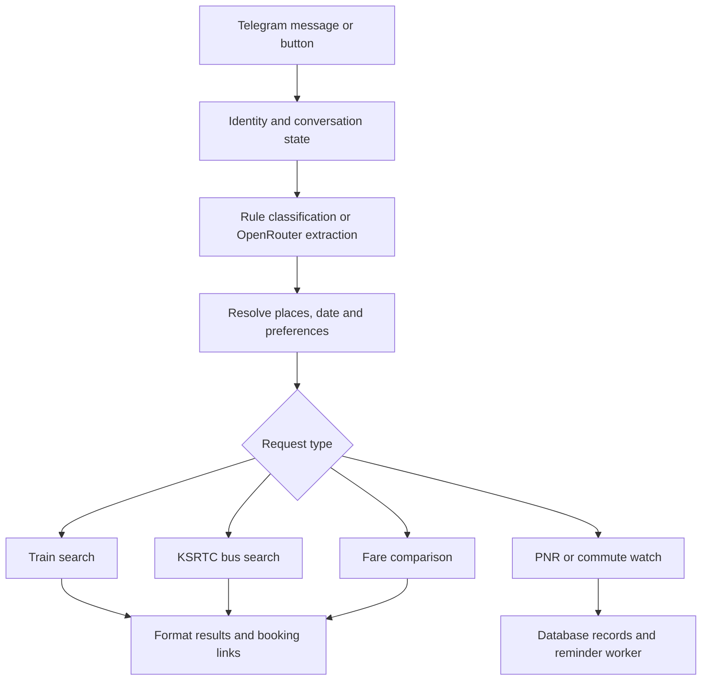

# Train-monitor: source review and reuse assessment

Reviewed: 9 October 2026. Reference commit: `770fdc1`.

## Evidence boundary

The original project is at `C:\Users\Admin\train-monitor`. A separate GitHub clone is at `C:\Users\Admin\Sahara\references\train-monitor`, from `JAN1729/train-monitor`. Top-level Python, SQL and Markdown files match the original after normalizing line endings. This check does not establish equality of every nested file or untracked artifact.

This review traced the active bot, provider adapters, fare comparison, alternative routes, place resolution, database access, PNR monitoring, daily commute monitoring, and calendar export. It did not start either bot worker, send notifications, read the original `.env`, execute database tests, install dependencies, or modify the original project. The original Git working-tree status command failed in this environment; file-content comparison was used for the relevant top-level sources instead.

The local graphify rule was consulted. Its existing graph query returned a small subgraph of a cached JSON result rather than the runtime architecture, so conclusions below come from source inspection.

## What the application actually is

The README primarily describes standalone train-search and scraping scripts. The current runtime is considerably broader: a Telegram travel assistant named WhatCheck/YathraSahara with train and KSRTC bus searches, conversational input, station resolution, fare comparison, alternative journeys, PNR tracking, recurring commute alerts, and calendar files.

The checked-in process declarations start:

- `whatcheck.py`: Telegram message and button handlers.
- `reminder_worker.py`: persistent reminders, PNR watches and daily commute checks.

`whatcheck_fixed.py` is another bot implementation; it is not the one selected by Procfile, Dockerfile, and Heroku configuration. FastAPI is a dependency, but the inspected active entry points do not expose a general multimodal planning API.

## Request flow

### Identity and sessions

The database integration identifies users using a channel and peer identifier. It maintains users, conversations and chat messages. Session state can be persisted to Supabase and restored, which is a stronger starting point than SaharaUser's placeholder-phone initialization.

The intent classifier includes up to eight recent history turns and structured state such as origin, destination and date. Clear requests such as greetings, PNR identifiers, cancellation and certain alerts bypass the LLM through local rules. Other requests use OpenRouter; the configured model string is `deepseek/deepseek-v4-flash`, whose provider availability was not tested.

The classifier normalizes model-produced intent scores and selects scores above a fixed threshold of 0.15, naming this a conformal set. There is no inspected calibration dataset or statistical calibration step supporting a formal conformal-prediction guarantee. Treat it as an ambiguity heuristic.

Session handling needs care when reused. `merge_intent_into_session()` explicitly resets origin, destination, date, class and time-filter fields before applying the new intent. That behavior must not erase unchanged journey constraints during a future refinement such as "same journey, less walking". Persisted session keys also omit some active fields, including the time filter, so restarting the bot may not preserve the whole planning context.

### Place resolution

`station_resolver.py` combines local caches, station-code recognition, preferred junctions, database lookup, a `resolve-location` Edge Function, fuzzy name search, and fallback aliases. Malayalam mappings exist in the bot and the backend resolver.

The bot additionally has hardcoded places without railway stations and nearby-junction suggestions. This is useful for places such as hill towns, but a multimodal backend should turn a city into a set of candidate access terminals, rather than unconditionally selecting one preferred railway station. Railway stations, bus boarding points, airports, and cities need separate identities.

Comments reference a large station database. Actual row counts and deployed coverage were not queried.

## Provider adapters

### Train availability

`whatcheck.run_train_search()`:

1. Checks known no-station locations.
2. Resolves input to railway codes and validates them.
3. Checks a Supabase cache with a 15-minute age limit.
4. Calls the ConfirmTkt primary adapter.
5. Falls back to RailYatri on failure or an empty result.
6. Logs successful searches and returns a structured result.

`monitor.run_confirmtkt_primary()` runs a browser-backed Scrapling fetch in a thread and parses train cards. The result includes train number/name, station labels, departure/arrival strings, duration, and class-level fare, availability, probability text and source update text. The direct URL includes the search date.

`run_railyatri_secondary()` parses timetable links and enclosing cards into a similar shape. Its imports use a different Scrapling import path from the primary adapter. Compatibility with the currently installed library is not established by reading the source.

The architecture can preserve these adapters behind an interface. It should not import `whatcheck.py` to perform a train query: that ties domain operations to Telegram logic, configuration loading, and bot state.

Provider failure currently can become a generic "No trains found on this route" message. A new backend must distinguish successful empty inventory from timeout, blocked source, parse failure, and unavailable access.

### Intercity buses

`bus_monitor.run_ksrtc_search()` resolves operator stop identifiers, formats the date, fetches the KSRTC SWIFT search page, and parses `srch-card` elements. It verifies parsed origin/destination labels to reduce contamination from unrelated page content and deduplicates services.

Fields include service name/type, departure/arrival clock strings, duration, fare and seat text. Unknown values are strings such as `Unknown`. A successful HTTP/parse pass can return zero buses; callers need to know whether that was truly empty inventory or a changed page layout.

This adapter covers a particular operator, not all Indian government and private buses. Its mappings are a starting point, not a national bus directory.

### Public reachability probes

Two credential-free HTTP GETs were made on 9 October 2026:

| Source | Result | What this establishes |
|---|---|---|
| ConfirmTkt ERS to SBC page for 10 October 2026 | HTTP 200, HTML, 7,342 characters | The public page was reachable; rendered inventory and parser output remain unverified |
| KSRTC city-list endpoint | HTTP 200, JSON, 598,851 characters | The city-directory endpoint responded; route inventory and current seats remain unverified |

The web reader could not open these endpoints; direct HTTP succeeded. Neither observation establishes sustainable provider access, permission to reuse data, fresh upstream observations, or a reliable production scraper.

## Fare comparison and split journeys

`fare_compare.compare_fares()` runs train and bus searches concurrently and returns cheapest-available and fastest summaries. It compares transport fares and service durations, not complete door-to-door journeys.

Important limitations:

- Fare parsers strip nonnumeric characters. Currency is implicit rather than represented in the result.
- Bus availability is derived from text, which can misclassify unknown or differently formatted zero-seat values.
- The fastest-bus path marks availability true without verifying the seats field.
- The fastest-train path may return an unavailable train with an availability flag. The presentation must not mistake fastest-scheduled for fastest-bookable.
- Local access costs, transfer costs, waiting, overnight accommodation, baggage and airport processing are absent.

`route_suggester.find_alternative_routes()` searches through up to five hardcoded hubs. Four searches per hub can mean 20 train/bus search jobs for one question. For each leg it prefers the cheapest available train; a bus is used only if no such train is found. It then adds the two service durations plus a fixed 60-minute transfer allowance and ranks by fare.

**This is alternative discovery, not a valid connection planner.** It does not compare the first leg's arrival datetime with the second leg's departure datetime. It also queries both legs on the same date, does not route between the actual terminals, and does not calculate actual waiting time. A cheap train arriving at 18:00 plus a bus leaving at 17:00 can therefore become a proposed combination.

Retain hub hints as optional candidate-discovery seeds. Replace independent cheapest-leg selection and fixed-buffer stitching with schedule-aware journey search.

## Live status and proactive monitoring

Despite its filename and some UI labels, `ntes_running_status.py` currently reads ConfirmTkt's public train-running-status page. It extracts an embedded JSON schedule and maps train status, delay and platform information.

Its active parser assigns scheduled arrival/departure strings to fields named `actual_arrival` and `actual_departure`, with a comment acknowledging a placeholder. Delay text is parsed separately. New code must not present those placeholders as measured actual times. Construct estimated times only when date/day offsets and delay data can be validated; otherwise leave estimates unknown.

`pnr_checker.py` checks a five-minute database cache, then a configured RapidAPI provider, then a ConfirmTkt endpoint. It normalizes passenger statuses and can create watches. `calculate_pnr_probability()` assigns fixed percentages according to waitlist type/position and class. Those are uncalibrated heuristics, not evidence-backed confirmation probabilities. The new planner should represent confirmed/RAC/waitlisted/unknown states and avoid invented probability claims.

The reminder worker:

- Loops over due reminders approximately every 20 seconds.
- Checks the PNR and commute work schedules approximately every five minutes.
- Applies per-watch PNR intervals, generally two hours for waitlisted tickets and six hours for other statuses, with an additional predeparture check condition.
- Sends change notifications and can offer a train-to-bus fallback.
- Looks up configured daily-commute boarding stations and reports live status when available.

Some comments and labels are stale, including NTES naming and check-window descriptions. These worker loops are not a high-frequency, end-to-end connection-risk monitor. New monitoring should refresh only relevant journey legs, compute whether a downstream connection remains feasible, and deduplicate alerts across workers.

No notifications were sent during this review.

## Persistence and deployment

The Supabase layer supplies search caching, availability records, channel identities, conversations, chat messages, reminders, PNR watches, session state and daily commutes. A thread-local proxy avoids sharing a single synchronous client across threads.

The two repositories have incompatible user identifiers: Sahara uses text `USR-...` IDs, while train-monitor migrations use bigint user records. They also use different configuration names and history schemas. Do not point both at one database and run all migrations expecting automatic compatibility. Use an explicit canonical identity model with mappings from each application's identifiers.

Several SQL policies are broad prototype policies. A consolidated service must enforce authenticated ownership on private sessions, tickets, watches and locations, and keep privileged provider/database credentials server-side.

The migration directory also contains an unrelated `hermes_alz` schema for a separate healthcare project. Exclude it from the commute migration set; do not deploy the entire directory indiscriminately.

The Docker configuration installs browser runtimes and starts the bot. This is relevant to deployment: browser-backed ingestion belongs in a Python worker/container, rather than assuming it can run inside Sahara's existing Deno Edge Function.

Rate limits currently use in-process dictionaries. They reset with process restarts and do not coordinate multiple instances. A shared broker needs durable/shared budgets, per-provider limits and request deduplication.

## Calendar export and tests

The calendar module creates `.ics` files and uses timezone-aware IST datetimes. It can infer arrival from duration. If duration is missing or unparsable, it defaults to eight hours; that default must not be used to claim a valid downstream connection.

Many `test_*.py` files are exploratory scripts, live provider checks or database-mutating integration scripts rather than isolated tests. Some load an older OpenClaw path and its `.env`. This review did not run them. A new suite should use sanitized recorded provider fixtures and side-effect-free planner tests, with explicitly separate opt-in provider and database smoke tests.

## Reuse recommendation

| Component | Decision |
|---|---|
| Train and KSRTC parsing | Adapt behind provider contracts; verify against fresh fixtures |
| Provider fallback and caching ideas | Keep, with freshness and typed errors |
| Malayalam/place aliases | Keep, with explicit geographic identity and ambiguity handling |
| Conversations and session persistence | Keep concepts; use a new canonical schema and refinement logic |
| Daily commute and PNR watches | Keep concepts; replace scheduling/notification coupling with durable jobs |
| Calendar export | Keep after removing invented arrival defaults |
| Hub-based alternatives | Use as discovery hints; replace connection validation and ranking |
| Fare comparison | Replace with full-journey comparison |
| Waitlist percentages | Do not reuse as calibrated predictions |
| Telegram monolith and direct notification functions | Keep as reference; do not import into the backend core |

The valuable combined foundation is Sahara's geographic interface and local bus data plus train-monitor's availability, language/place resolution, persistent state and watches. The missing core is a normalized, time-aware, evidence-backed journey engine.
